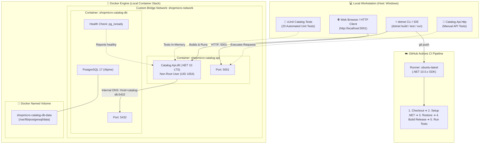
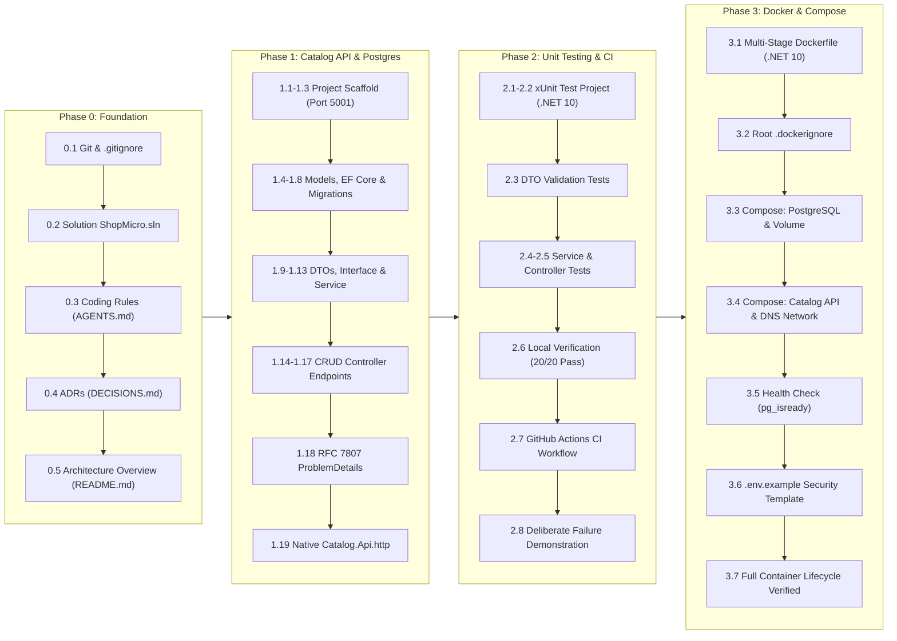
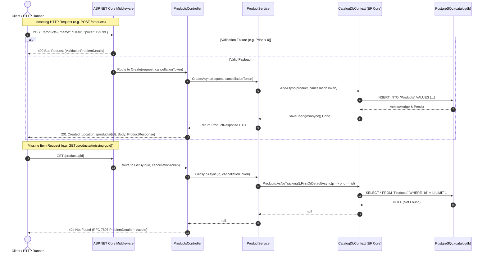
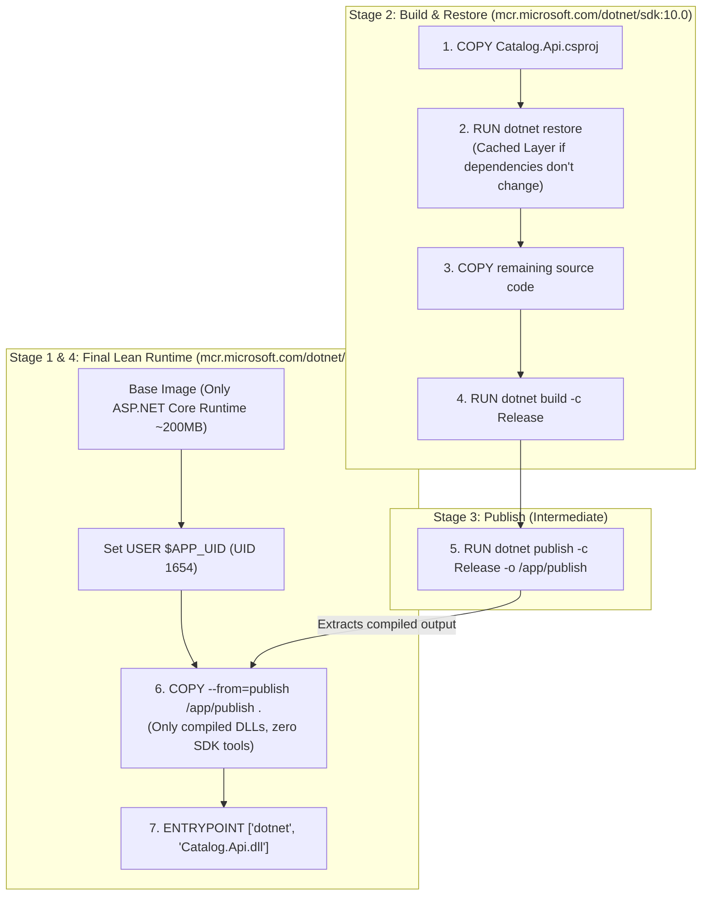
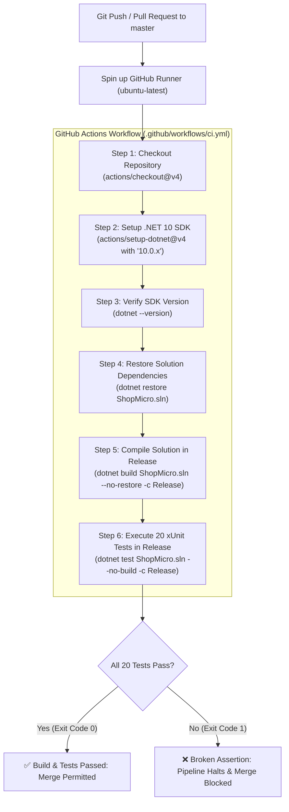

# ShopMicro: Complete Architectural Journey & Progress Flow

This document provides a comprehensive visual and structural breakdown of everything built in **ShopMicro** from **Phase 0** through **Phase 3**.

> 💡 **Tip:** An interactive, fully-rendered web view of this document is available at [docs/GRAPHICAL_FLOW.html](file:///d:/CICD/docs/GRAPHICAL_FLOW.html). You can double-click it in Windows Explorer or open it in any browser to see interactive, rendered SVG diagrams!

---

## 1. System Architecture Map (Where We Are Today)

---

## 2. Step-by-Step Implementation Timeline

Every task has been completed and verified atomically:

---

## 3. The API Request-Response Lifecycle

Here is how an incoming HTTP request traverses the Catalog service:

---

## 4. Multi-Stage Docker Build Flow

Our multi-stage Docker build guarantees minimal container size and non-root runtime security:

---

## 5. Automated CI Pipeline Flow

Every commit or pull request against `master`/`main` executes this automated validation pipeline:

---

## 6. Comprehensive Phase Progress Matrix

| Phase | Description | Key Artifacts & Accomplishments | Status |
| :--- | :--- | :--- | :---: |
| **Phase 0** | **Environment & Decisions** | [ShopMicro.sln](file:///d:/CICD/ShopMicro.sln), [AGENTS.md](file:///d:/CICD/AGENTS.md), [DECISIONS.md](file:///d:/CICD/docs/DECISIONS.md) (ADR-001 through ADR-005) | **Completed** |
| **Phase 1** | **Catalog API & PostgreSQL** | [Product.cs](file:///d:/CICD/src/Catalog.Api/Models/Product.cs), [CatalogDbContext.cs](file:///d:/CICD/src/Catalog.Api/Data/CatalogDbContext.cs), [ProductService.cs](file:///d:/CICD/src/Catalog.Api/Services/ProductService.cs), [ProductsController.cs](file:///d:/CICD/src/Catalog.Api/Controllers/ProductsController.cs), [Catalog.Api.http](file:///d:/CICD/src/Catalog.Api/Catalog.Api.http) | **Completed** |
| **Phase 2** | **Unit Testing & CI Pipeline** | [Catalog.Tests.csproj](file:///d:/CICD/tests/Catalog.Tests/Catalog.Tests.csproj), 20 Unit Tests ([Validation](file:///d:/CICD/tests/Catalog.Tests/CreateProductRequestValidationTests.cs), [Service](file:///d:/CICD/tests/Catalog.Tests/ProductServiceTests.cs), [Controller](file:///d:/CICD/tests/Catalog.Tests/ProductsControllerTests.cs)), [.github/workflows/ci.yml](file:///d:/CICD/.github/workflows/ci.yml) | **Completed** |
| **Phase 3** | **Docker & Local Compose** | [Dockerfile](file:///d:/CICD/src/Catalog.Api/Dockerfile), [.dockerignore](file:///d:/CICD/.dockerignore), [docker-compose.yml](file:///d:/CICD/docker-compose.yml), [.env.example](file:///d:/CICD/.env.example) | **Completed** |
| **Phase 4** | **Order API & Inter-Service Calls** | Order microservice, SQL Server, inter-service `HttpClient` with resilience, `POST /orders` | **Next Up** |
| **Phase 5** | **YARP Gateway & Redis Caching** | Reverse proxy, cache-aside pattern, route dispatching | Upcoming |
| **Phase 6** | **RabbitMQ & Asynchronous Worker** | MassTransit, `OrderCreatedEvent`, Outbox pattern, notification worker | Upcoming |
| **Phase 7** | **Observability & Health Checks** | OpenTelemetry, Serilog, Seq container, `/health/live`, `/health/ready` | Upcoming |
| **Phase 8** | **Azure Cloud Deployment** | Azure Container Apps, Azure DB for PostgreSQL, Azure SQL, Key Vault | Upcoming |
| **Phase 9** | **Security & Polish** | Rate limiting, authentication/authorization | Upcoming |

---

## 7. Next Step: Phase 4 Milestone

We are ready to start **Phase 4: Order API & Synchronous Inter-Service Communication**.

The immediate first step will be:
* **Task 4.1:** Scaffold the `Order.Api` ASP.NET Core Web API project targeting **.NET 10 LTS** with Controllers and attach it to [ShopMicro.sln](file:///d:/CICD/ShopMicro.sln).
